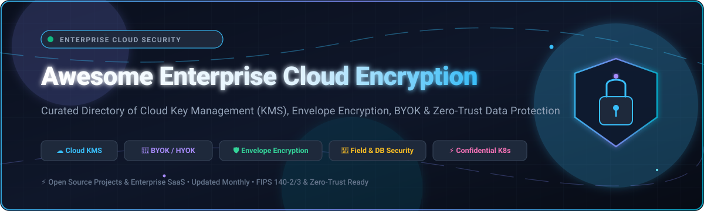

<p align="center">
  
</p>

<p align="center">
  <a href="https://github.com/ishandutta2007/Awesome-Awesome-Awesome"></a><a href="https://discord.gg/jc4xtF58Ve"></a>
  <a href="https://github.com/ishandutta2007/Awesome-Enterprise-Cloud-Encryption/stargazers"></a>
  <a href="https://github.com/ishandutta2007/Awesome-Enterprise-Cloud-Encryption/network/members"></a>
  <a href="https://github.com/ishandutta2007/Awesome-Enterprise-Cloud-Encryption/blob/main/LICENSE"></a>
  <a href="https://github.com/ishandutta2007/Awesome-Enterprise-Cloud-Encryption/pulls"></a>
  <a href="https://github.com/ishandutta2007/Awesome-Enterprise-Cloud-Encryption"></a>
  <a href="https://github.com/ishandutta2007"></a>
</p>

---

# 🔐 Awesome Enterprise Cloud Encryption

> **The definitive directory of Enterprise Cloud Encryption platforms, Key Management Services (KMS), Envelope Encryption SDKs, Bring Your Own Key (BYOK/HYOK) architectures, and Zero-Trust cryptographic infrastructure.**

Welcome to the **Awesome Enterprise Cloud Encryption** ecosystem repository. This resource provides security architects, DevSecOps teams, compliance officers, and platform engineers with a structured, verified directory of **commercial SaaS platforms** and **open-source GitHub projects** designed to secure sensitive data-at-rest across multi-cloud, hybrid-cloud, database, and Kubernetes environments.

---

## 📑 Table of Contents

- [📊 Sector Overview & Market Dynamics](#-sector-overview--market-dynamics)
- [🏢 SaaS & Hosted Enterprise Encryption Platforms](#-saas--hosted-enterprise-encryption-platforms)
- [💻 Open-Source GitHub Projects](#-open-source-github-projects)
- [🧱 Architectural Blueprints & Patterns](#-architectural-blueprints--patterns)
- [🔍 SEO Taxonomy & Domain Keywords](#-seo-taxonomy--domain-keywords)
- [🤝 How to Contribute](#-how-to-contribute)
- [⚖️ Disclaimer & Compliance Notice](#️-disclaimer--compliance-notice)
- [##  Star History](#--star-history)
- [💖 Support & Sponsoring](#-support--sponsoring)

---

## 📊 Sector Overview & Market Dynamics

The global **cloud encryption market** is valued at approximately **$5.27B – $6.91B (2025–2026)** and is projected to expand rapidly at a compound annual growth rate (**CAGR of ~22.9% – 24.5%**), crossing **$36.5B – $39.8B by 2034–2035**. This acceleration is propelled by strict global data sovereignty regulations (GDPR, HIPAA, PCI-DSS 4.0, DORA, NIS2) and widespread enterprise adoption of multi-tenant cloud storage and AI workloads.

From a structural market perspective, the sector exhibits a **bifurcated barbell concentration**:
- **Hyper-Concentrated Hyperscale Foundation (Winner-Take-Most):** At the core infrastructure layer (block storage, object storage, and baseline key management), the market is heavily consolidated among the "Big Three" hyperscalers—**Microsoft Azure**, **Alphabet / Google Cloud**, and **Amazon Web Services (AWS)**. Due to friction-free integration with native cloud compute, they capture the overwhelming majority of standard key transactions.
- **Moderately Fragmented Application & Multi-Cloud Layer:** Conversely, multi-cloud key orchestration, database field-level tokenization, Bring Your Own Key (BYOK) / Hold Your Own Key (HYOK), and confidential computing remain **moderately fragmented**. Independent software vendors (HashiCorp/IBM, Thales, Protegrity, Baffle) and vibrant open-source projects thrive because enterprises actively resist single-cloud vendor lock-in and require neutral, cross-cloud key custody to guarantee cryptographic independence.

---

## 🏢 SaaS & Hosted Enterprise Encryption Platforms

Below is the verified comparison of leading enterprise SaaS and hosted cloud encryption platforms. Each entry includes transparent starting tier pricing, explicit free tier or free trial limits, and official company scale metrics (market valuation and annual revenue), sorted in descending order of vendor scale.

| 🏢 Platform / Vendor | 📈 Company Scale (Valuation / Revenue) | 💰 Specific Starting Tier Pricing | 🎁 Specific Free Tier / Trial Limits | 🛡️ Key Cloud Encryption Capabilities |
| :--- | :--- | :--- | :--- | :--- |
| **[Azure Key Vault](https://azure.microsoft.com/en-us/products/key-vault/)**<br>*(Microsoft)* | **Valuation: ~$3.10T**<br>Revenue: ~$245.1B/yr *(Mega-Cap)* | **$0.03 per 10,000 operations** for standard keys and secrets ($0.00 base storage cost for software secrets) | **$200 credit for 30 days** + 12 months of popular free services; standard secret storage incurs **$0.00 monthly base fee forever** | Managed HSM (FIPS 140-2 Level 3), Entra ID RBAC, automated rotation, double encryption at rest, customer-managed keys (CMK) across Azure. |
| **[Google Cloud KMS](https://cloud.google.com/security-key-management)**<br>*(Alphabet / Google Cloud)* | **Valuation: ~$2.15T**<br>Revenue: ~$307.4B/yr *(Mega-Cap)* | **$0.06 per active key version/mo** + **$0.03 per 10,000 cryptographic operations** | **100 active key versions/mo & 10,000 operations/mo free forever** via Cloud KMS Autokey; destroyed keys free; **$300 credit for 90 days** | Cloud EKM (External Key Manager) for external key custody, Cloud HSM, CMEK, Key Justification Reason (KJR), confidential VM key integration. |
| **[AWS KMS](https://aws.amazon.com/kms/)**<br>*(Amazon Web Services)* | **Valuation: ~$1.95T**<br>Revenue: ~$574.8B/yr (AWS ~$105B) *(Mega-Cap)* | **$1.00 per Customer Managed Key (CMK)/mo** + **$0.03 per 10,000 requests** (after free tier) | **20,000 requests/month free forever** (aggregated across all AWS Regions; CMKs $1/mo excluded); AWS-managed keys free | Transparent envelope encryption across 100+ AWS services, multi-Region keys, XKS (External Key Store / HYOK), CloudHSM integration, CloudTrail auditing. |
| **[Salesforce Platform Encryption](https://help.salesforce.com/s/articleView?id=platform.shield_ext_pe_analyzer.htm&type=5)**<br>*(Salesforce)* | **Valuation: ~$280B**<br>Revenue: ~$34.9B/yr *(Large-Cap)* | **20% of net Salesforce license spend** (or 30% for full Salesforce Shield bundle) | **Free forever in Salesforce Developer Edition orgs** (up to 5MB data / 20MB file storage); **30-day enterprise trial** for sandbox testing | Native AES-256 field-level symmetric encryption preserving search, workflows, and validation; BYOK via HSM/web service; Data Cloud key management. |
| **[HashiCorp Vault](https://www.hashicorp.com/)**<br>*(IBM / HashiCorp)* | **Valuation: ~$200B** (IBM parent; acq. $6.4B)<br>Revenue: ~$62.0B/yr *(Large-Cap)* | **$0.03/hour** (HCP Vault Secrets) or **$0.616/hour** (~$444/mo for Dedicated Dev cluster, up to 25 clients) | **$500 free trial credits** across HCP services; **HCP Vault Secrets Starter tier free forever** (up to 50 active secrets) | Transit secrets engine for Encryption-as-a-Service (EaaS), dynamic short-lived credentials, automated PKI, multi-cloud key synchronization, KMIP server. |
| **[Thales CipherTrust](https://cpl.thalesgroup.com/)**<br>*(Thales Group)* | **Valuation: ~$38B**<br>Revenue: ~€18.4B (~$20.1B/yr) *(Mid/Large-Cap)* | **€165/month (~$180/mo)** for CipherTrust Transparent Encryption (CTE); CCKM from **€1,220/month** via DPoD | **30-day free trial** on DPoD Marketplace; **CipherTrust Community Edition free forever** (includes 2 enterprise connector licenses) | Transparent OS/file-system encryption, multi-cloud key manager (CCKM) for AWS/Azure/GCP/Salesforce, Luna HSM root-of-trust, database tokenization. |
| **[CipherCloud](https://www.ciphercloud.com/)**<br>*(Lookout)* | **Valuation: ~$1.50B**<br>Revenue: ~$130M/yr *(Unicorn)* | **$8.00 – $15.00 per user/month** (starting enterprise CASB / cloud data security tier) | **14-day guided sandbox pilot / proof-of-concept (PoC)** with sales engineering deployment (no self-serve free plan) | Cloud Access Security Broker (CASB) with application-layer field encryption, format-preserving tokenization for Salesforce, Microsoft 365, and Box. |
| **[Protegrity](https://www.protegrity.com/)**<br>*(Harvest Partners / Protegrity)* | **Valuation: ~$500M**<br>Revenue: ~$80M – $100M/yr *(Mid-Market PE)* | **$15,000/year base deployment tier** (AWS Marketplace contracted unit bundle) | **Free forever Protegrity Developer Edition** (containerized Python toolkit with Find & Protect APIs); **30-day enterprise PoC** | Format-Preserving Encryption (FPE), vaultless tokenization, dynamic data masking, multi-cloud data protection across Snowflake, BigQuery, and Databricks. |
| **[Baffle](https://baffle.io/)**<br>*(Baffle, Inc.)* | **Valuation: ~$120M**<br>Revenue: ~$12M – $15M/yr *(Series B Growth)* | **$0.50 per hour (~$365/mo)** on AWS Marketplace (for `t3.large` data proxy instance) | **30-day free software license trial** on AWS Marketplace for Amazon S3 / RDS & Aurora PostgreSQL (AWS compute charged separately) | No-code SQL/NoSQL database encryption proxies, record-level tokenization, privacy-preserving analytics, and data pipeline proxies for Amazon S3. |
| **[Townsend Security](https://www.townsendsecurity.com/)**<br>*(Townsend Security)* | **Valuation: ~$40M**<br>Revenue: ~$10M – $12M/yr *(Privately held SME)* | **$4,800/year (~$400/mo)** for Alliance Key Manager Cloud/VM entry license tier | **30-day free evaluation license** on AWS Marketplace / Azure VM (full enterprise KMIP and automated key rotation functionality) | Alliance Key Manager with FIPS 140-2 Level 1 & 3 validation, KMIP compliance, automated rotation, and transparent encryption for SQL Server & Oracle. |

---

## 💻 Open-Source GitHub Projects

The open-source community provides powerful building blocks for zero-trust key management, GitOps configuration encryption, envelope encryption, and confidential cloud computing. The table below lists the top active open-source projects, equipped with live social Stars_Badges and sorted strictly in **descending order of GitHub stargazers**.

| 📦 Repository & Project | ⭐ Stargazers Count | 📜 License | 🛠️ Core Cryptographic Capabilities |
| :--- | :--- | :--- | :--- |
| **[HashiCorp Vault](https://github.com/hashicorp/vault)** | [](https://github.com/hashicorp/vault/stargazers) | BSL-1.1 | Industry-standard secrets lifecycle management, Transit secrets engine for Encryption-as-a-Service (EaaS), dynamic leasing, and PKI orchestration. |
| **[Infisical](https://github.com/Infisical/infisical)** | [](https://github.com/Infisical/infisical/stargazers) | MIT / Elastic | End-to-end encrypted secret management platform, certificate lifecycle management, and privileged access workflows with native Kubernetes integrations. |
| **[age](https://github.com/FiloSottile/age)** | [](https://github.com/FiloSottile/age/stargazers) | BSD-3-Clause | Simple, modern, and secure file encryption CLI and Go library featuring small explicit keys, no brittle config options, and UNIX pipe composability. |
| **[SOPS](https://github.com/getsops/sops)** | [](https://github.com/getsops/sops/stargazers) | MPL-2.0 | Structure-preserving configuration file encryption (YAML, JSON, ENV, INI) with multi-master key support across AWS KMS, GCP KMS, Azure Key Vault, age, and PGP. |
| **[Cryptomator](https://github.com/cryptomator/cryptomator)** | [](https://github.com/cryptomator/cryptomator/stargazers) | GPL-3.0 | Multi-platform client-side encryption utility for untrusted cloud storage (Dropbox, Google Drive, OneDrive, S3), preventing cloud provider data snooping. |
| **[Google Tink](https://github.com/tink-crypto/tink)** | [](https://github.com/tink-crypto/tink/stargazers) | Apache-2.0 | Multi-language (C++, Java, Go, Python) cryptographic library by Google providing misuse-resistant APIs, envelope encryption, and native AWS/GCP KMS key wrapping. |
| **[Sealed Secrets](https://github.com/bitnami/sealed-secrets)** | [](https://github.com/bitnami/sealed-secrets/stargazers) | Apache-2.0 | Kubernetes controller and `kubeseal` CLI for asymmetric one-way encryption, enabling safe storage of encrypted secrets in public version control for GitOps. |
| **[Smallstep Certificates](https://github.com/smallstep/certificates)** | [](https://github.com/smallstep/certificates/stargazers) | Apache-2.0 | Private certificate authority (X.509 & SSH) and ACME server for automated mutual TLS (mTLS), identity-based microservice encryption, and zero-trust mesh keys. |
| **[OpenBao](https://github.com/openbao/openbao)** | [](https://github.com/openbao/openbao/stargazers) | MPL-2.0 | Community-driven, fully open-source fork of HashiCorp Vault maintained under the Linux Foundation for managing sensitive secrets, certificates, and transit keys. |
| **[gopass](https://github.com/gopasspw/gopass)** | [](https://github.com/gopasspw/gopass/stargazers) | MIT | Terminal-based password and secret manager for engineering teams utilizing GPG, Age, and Git for distributed, cryptographically signed secret trees. |
| **[External Secrets Operator](https://github.com/external-secrets/external-secrets)** | [](https://github.com/external-secrets/external-secrets/stargazers) | Apache-2.0 | Kubernetes operator synchronizing secrets from external APIs (AWS Secrets Manager, HashiCorp Vault, GCP Secret Manager, Azure Key Vault) directly into K8s Secrets. |
| **[Constellation](https://github.com/edgelesssys/constellation)** | [](https://github.com/edgelesssys/constellation/stargazers) | Apache-2.0 | Confidential Kubernetes distribution providing end-to-end encryption in memory and at rest across public clouds using AMD SEV-SNP and Intel TDX attestation. |
| **[CyberArk Conjur](https://github.com/cyberark/conjur)** | [](https://github.com/cyberark/conjur/stargazers) | Apache-2.0 | Identity-centric secrets management platform securing secrets for containerized workloads, CI/CD runners, and cloud services with granular RBAC policies. |
| **[RustyVault](https://github.com/Tongsuo-Project/RustyVault)** | [](https://github.com/Tongsuo-Project/RustyVault/stargazers) | Apache-2.0 | High-performance secrets manager in Rust featuring Vault-compatible REST APIs, PKI, national cryptographic standards (SM2/SM4), and Paillier homomorphic encryption. |
| **[Cosmian KMS](https://github.com/Cosmian/kms)** | [](https://github.com/Cosmian/kms/stargazers) | AGPL-3.0 | Pure Rust KMIP 1.4-compliant key management system with FIPS 140-3 readiness, fine-grained access policies, and enterprise multi-cloud key lifecycle controls. |
| **[AWS Encryption SDK](https://github.com/aws/aws-encryption-sdk-python)** | [](https://github.com/aws/aws-encryption-sdk-python/stargazers) | Apache-2.0 | Client-side envelope encryption library supporting multiple master key providers (AWS KMS, raw RSA/AES keys), cryptographic material caching, and framed data. |
| **[Clef](https://github.com/clef-sh/clef)** | [](https://github.com/clef-sh/clef/stargazers) | MIT | Lightweight, tokenless secrets-as-code layer running directly on Git and cloud KMS (AWS, GCP, Azure) without persistent server daemons. |
| **[secrets (Go)](https://github.com/allisson/secrets)** | [](https://github.com/allisson/secrets/stargazers) | MIT | Minimalist secrets manager in Go featuring envelope encryption, transit encryption (EaaS), tokenization, Argon2id auth, and OpenTelemetry instrumentation. |
| **[HyperionDB Vault](https://github.com/hyperiondb/hyperion-vault)** | [](https://github.com/hyperiondb/hyperion-vault/stargazers) | MIT | Replicated secrets vault in Rust featuring AWS KMS-wrapped envelope encryption, XChaCha20-Poly1305 sealed secrets, Raft consensus, and embedded redb storage. |
| **[Nexus](https://github.com/ConstantineCTF/nexus)** | [](https://github.com/ConstantineCTF/nexus/stargazers) | MIT | Enterprise-grade secrets management featuring AES-256-GCM encryption, Ed25519-signed immutable audit trails, and single-binary deployment. |

---

## 🧱 Architectural Blueprints & Patterns

Building a resilient, production-ready enterprise cloud encryption architecture typically involves layered patterns:

```
┌────────────────────────────────────────────────────────────────────────┐
│                        Zero-Trust Client Layer                         │
│   (Web Browsers, Mobile Apps, Microservices, CI/CD Pipeline Runners)   │
└───────────────────────────────────┬────────────────────────────────────┘
                                    │ Application Data (Plaintext)
                                    ▼
┌────────────────────────────────────────────────────────────────────────┐
│                     Client-Side Envelope Encryption                    │
│   - Google Tink / AWS Encryption SDK generates local Data Key (DEK)   │
│   - Plaintext payload encrypted with AES-256-GCM or ChaCha20-Poly1305   │
└───────────────────┬────────────────────────────────┬───────────────────┘
                    │ Request Wrapped DEK            │ Ciphertext Payload
                    ▼                                ▼
┌───────────────────────────────────────┐ ┌──────────────────────────────┐
│        Key Management Service         │ │      Cloud Storage / DB      │
│   - AWS KMS / Azure Key Vault / GCP   │ │   - S3 / Blob / Cloud SQL    │
│   - HashiCorp Vault / OpenBao / KMIP  │ │   - Encrypted with DEK       │
│   - Master Key (KEK) stays in HSM     │ │   - Wrapped DEK stored with  │
│   - FIPS 140-2/3 Hardware Root        │ │     ciphertext header        │
└───────────────────────────────────────┘ └──────────────────────────────┘
```

1. **Envelope Encryption Pattern (DEK + KEK):**  
   Generate a unique Data Encryption Key (DEK) locally using high-throughput symmetric ciphers (AES-256-GCM / XChaCha20-Poly1305). Encrypt large data payloads locally and wrap the DEK using a Key Encryption Key (KEK) stored inside an HSM-backed KMS (AWS KMS, Azure Key Vault, Google Cloud KMS, OpenBao).
2. **Bring Your Own Key (BYOK) & Hold Your Own Key (HYOK):**  
   Maintain key custody within on-premises or co-located Hardware Security Modules (Thales Luna HSM, CloudHSM) and route cloud cryptographic operations through external key managers (AWS XKS, Google Cloud EKM).
3. **GitOps Secret Workflow:**  
   Store encrypted configurations directly in Git using **SOPS** or **Sealed Secrets**, decrypting only at runtime inside the Kubernetes cluster via the **External Secrets Operator**.
4. **Confidential Computing Enclaves:**  
   Deploy workloads inside encrypted hardware memory enclaves (AMD SEV-SNP, Intel TDX via **Constellation**) to shield sensitive in-memory cryptographic keys from untrusted cloud hypervisors and host operators.

---

## 🔍 SEO Taxonomy & Domain Keywords

To assist security engineers and compliance teams in finding verified cloud data protection tooling, this repository is indexed against core industry domains:

- **Key Management & KMS:** `cloud-kms`, `key-management-service`, `kmip-server`, `key-rotation`, `envelope-encryption`, `customer-managed-keys`, `cmk`, `hsm`, `fips-140-3`.
- **Cloud Data Protection & Compliance:** `cloud-encryption`, `data-at-rest-encryption`, `byok`, `hyok`, `field-level-encryption`, `format-preserving-encryption`, `tokenization`, `soc-2`, `pci-dss-4.0`, `hipaa`, `gdpr`, `dora`.
- **Zero-Trust & DevSecOps:** `gitops-secrets`, `secrets-management`, `confidential-computing`, `kubernetes-secrets`, `zero-trust-architecture`, `post-quantum-cryptography`.

---

## 🤝 How to Contribute

Contributions from the cloud security and cryptography community are warmly welcomed!

1. 🍴 **Fork the repository** on GitHub.
2. 🌿 **Create a descriptive feature branch**: `git checkout -b feature/add-new-encryption-tool`.
3. 📝 **Add or update an entry**: Ensure accurate pricing, explicit free tier limits, vendor scale metrics, and valid stargazers badges.
4. 🧪 **Verify link integrity and markdown formatting**.
5. 🚀 **Submit a Pull Request** with a brief summary of the proposed changes.

*Check out the overarching collection of curated resources at [Awesome-Awesome-Awesome](https://github.com/ishandutta2007/Awesome-Awesome-Awesome).*

---

## ⚖️ Disclaimer & Compliance Notice

- This repository is a **community-curated index** provided for educational, architectural, and evaluation purposes; it does not constitute a formal commercial endorsement.
- Enterprise deployments processing regulated data (PII, PHI, financial records, defense data) must validate individual solution compliance against applicable statutory frameworks (**FIPS 140-2/3**, **SOC 2 Type II**, **ISO 27001**, **FedRAMP High**, **PCI-DSS 4.0**).
- Self-hosted open-source encryption engines require rigorous operational hardening, persistent disaster-recovery backups, secure entropy generation, and strict key custody policies.

---

##  Star History

[](https://star-history.dera.page/#ishandutta2007/Awesome-Enterprise-Cloud-Encryption&type=date&legend=top-left)

---

## 💖 Support & Sponsoring

Thank you for visiting and supporting **Awesome Enterprise Cloud Encryption**! If this curated guide, market analysis, or open-source tooling collection has helped you, your team, or your enterprise navigate cloud security architecture:

- ⭐ **Star this repository** on GitHub to amplify its reach.
- 🍴 **Fork and share** with colleagues, DevSecOps practitioners, and security architects.
- ☕ **Sponsor & Buy a Coffee**: Support continuous research and open-source curation via the [GitHub Sponsor Dashboard](https://github.com/sponsors/iahandutta2007).
